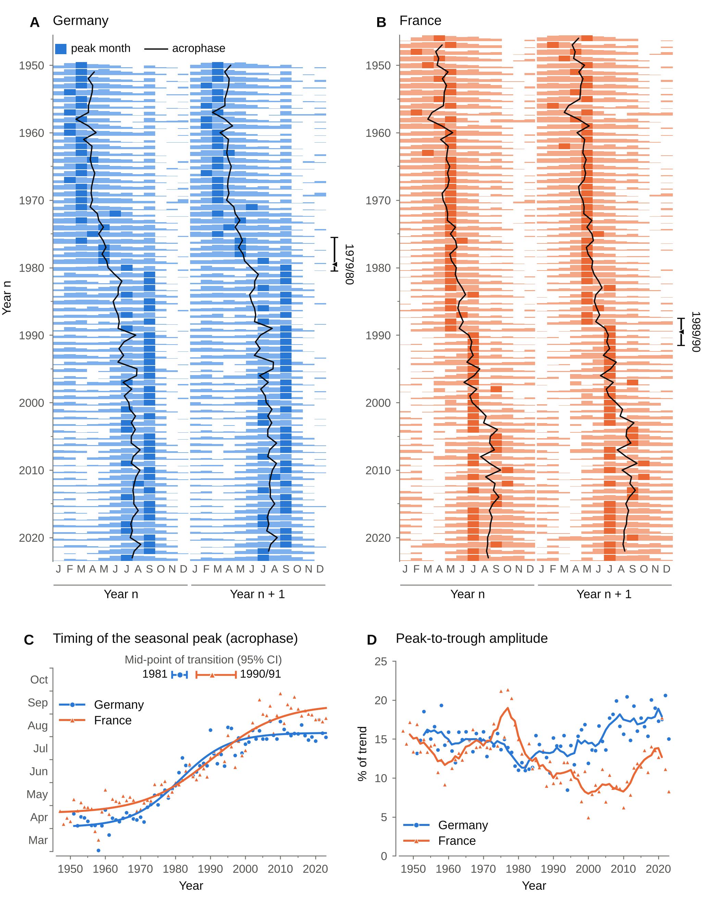

# Comparative birthograms reveal country‑specific rephasing of human birth seasonality

Code, data and results for the paper entitled "Comparative birthograms reveal country‑specific
rephasing of human birth seasonality" (Timothy J Hearn and Bethan Lloyd-Owen).

This is version 2.0.0, the revised analysis. It replaces the analysis of v1.0.0, and some of the
conclusions drawn from v1.0.0 no longer stand: see [Results in brief](#results-in-brief) and
[What changed from v1.0.0](#what-changed-from-v100). The v1.0.0 notebooks are kept unchanged in
[`v1.0.0/`](v1.0.0) for the record.

All versions are archived on Zenodo: https://doi.org/10.5281/zenodo.19066197



## Run

```
pip install -r requirements.txt
python birth_seasonality_analysis.py data results   # annual measures, tests, transition fits (about 11 minutes on two processors)
python figure1.py data results Figure1              # Figure1.pdf / .png / .tiff (600 dpi)
python reviewer_checks.py data results              # supporting checks made during peer review (under a minute)
python validation_simulations.py results            # size and coverage of the bootstrap procedures (about 20 minutes on two processors)
```

`statsmodels` is needed only by `reviewer_checks.py`, which re-runs the v1.0.0 method.
Every procedure has its own seeded random stream, so the files in `results/` are reproduced
exactly with the package versions noted in `requirements.txt`.

## Files

| File | Contents |
| --- | --- |
| `birth_seasonality_analysis.py` | the analysis: annual measures, break tests, transition fits |
| `figure1.py` | draws Figure 1 from the data and the results |
| `reviewer_checks.py` | supporting checks, including a re-run of the v1.0.0 statistics |
| `validation_simulations.py` | simulations that test the inferential procedures on series with a known answer |
| `data/german data.csv` | live births by month, Germany, 1950-2024 (former FRG and former GDR combined in all years) |
| `data/french data.csv` | live births by month, metropolitan France, 1946-2024 |
| `data/*_photoperiod_data.csv` | day length used in v1.0.0; read only by `reviewer_checks.py` |
| `results/annual_metrics.csv` | acrophase, amplitude and peak month for every complete year |
| `results/seasonal_index_by_month.csv` | births per day as % of the centred 12-month trend |
| `results/break_tests.csv` | largest shift in mean for each annual series: sup-F, p-values, break year, Bai interval, range under counting noise, reported interval |
| `results/phase_transition_fits.csv` | logistic transition in acrophase: mid-point, duration, intervals, step-versus-gradual test |
| `results/results_summary.txt` | every number quoted in the manuscript |
| `results/reviewer_checks.txt` | output of `reviewer_checks.py` |
| `results/validation_simulations.txt` | simulated size and coverage of the tests and intervals |
| `Figure1.pdf`, `Figure1.png` | Figure 1 |
| `v1.0.0/` | the notebooks of the first submission (superseded) |

## Data sources

* Germany: Destatis GENESIS-Online, table 12612-0002,
  https://www-genesis.destatis.de/datenbank/online/statistic/12612/table/12612-0002
* France: INSEE, series 000436391, https://www.insee.fr/en/statistiques/serie/000436391
* Day length (used in v1.0.0 only): mean daily daylight duration in each calendar month in
  Berlin and Paris, from the Open-Meteo Historical Weather API.

The files have no header. The birth files hold year, month, live births and a fourth column
left over from v1.0.0 that the revised analysis ignores. The photoperiod files hold year, month,
live births and day length in hours.

## Results in brief

All numbers are in `results/results_summary.txt`.

* Germany: the peak month of births switched from spring to late summer between 1979 and 1980
  (95% interval 1975/76 to 1980/81; sup-F = 489.4, p = 0.0009).
* France: the peak switched from May to July between 1989 and 1990 (95% interval 1987/88 to
  1991/92; sup-F = 166.9, p = 0.0039), a decade after Germany.
* In both countries the switch was one step in a gradual drift of the seasonal distribution.
  A logistic transition in the acrophase has its mid-point in 1981.25 in Germany (95% CI
  1979.00 to 1983.25), with the central 80% of the shift taking 30.5 years (23.0 to 39.5), and
  in 1990.50 in France (1986.00 to 1997.25), taking 43.0 years (27.0 to 88.0, an upper limit
  that is imprecise: see [What the simulations show](#what-the-simulations-show)). One
  instantaneous step is rejected in both (p = 0.0001).
* Relative amplitude shows no significant shift in either country (p = 0.063 in Germany,
  p = 0.32 in France).
* Not supported by the revised analysis: the 1971 "break" in German amplitude reported in
  v1.0.0, which reflected the fall in the number of births, and the contrast between an abrupt
  rephasing in France and a gradual one in Germany.

## Method in brief

1. Monthly counts are divided by the number of days in the month and, in logs, by a centred
   12-month moving average. Nothing is smoothed across years.
2. For each calendar year: the peak month, the acrophase of a single-harmonic fit to the 12
   monthly indices, and the peak-to-trough amplitude in % of trend.
3. Peak month and amplitude are tested for a shift in mean at an unknown date with the sup-F
   statistic (15% trimming). P-values come from a double sieve bootstrap under the null
   hypothesis of no shift (9,999 first-level series, 999 second-level series for each). The
   break year carries a Bai (1997) 95% confidence interval with regime-specific long-run
   variances. That interval takes each year's peak month as given, yet in some years the
   highest month leads the next by less than the counting noise in monthly births. The
   interval for the peak-month break is therefore widened to the 95% range of the estimate
   when every monthly count is redrawn as a Poisson variate (1,999 replicates).
4. The acrophase drifts gradually, and a test for one shift in mean is not reliable for such a
   series (see `results/validation_simulations.txt`). A logistic curve is fitted to it instead,
   giving the mid-point of the transition and the time taken for its central 80%, with
   intervals calibrated by a double bootstrap. A bootstrap likelihood-ratio test compares the
   curve with one instantaneous step.

## What the simulations show

* A single bootstrap sup-F test finds a "shift" too often when the series is very persistent
  (up to 27% at the 5% level); the double bootstrap brings the peak-month and amplitude tests
  to 3-5%. It remains too liberal for acrophase-like series (11-12%), which is one reason the
  acrophase is fitted with a transition curve and not tested for a single shift.
* Estimating the error process after removing the best-fitting shift, a common shortcut,
  rejects a true null far too often and is not used.
* Bai intervals for the peak-month break cover the true year in 99-100% of series.
* The step-versus-gradual test rejects a true step in 6% (German-like) and 10% (French-like)
  of series at the 5% level; the observed statistics exceed the largest of 1,000 simulated
  under a step.
* Plain percentile intervals for the French logistic transition are too narrow (coverage
  88-89%), hence the calibration. The calibrated upper limit for the French duration is
  imprecise (88 years tail by tail, 82 with one common level) and close to the 77 years
  observed: the data barely bound the length of the French transition from above.

## What changed from v1.0.0

* Births per day replace monthly counts.
* Amplitude is relative to trend. Absolute amplitude follows the number of births: a synthetic
  series with an unchanging seasonal profile reproduces the 1971 German "break".
* Seasonal indices are no longer the STL seasonal component, which averages about seven years.
* Peak month and acrophase are analysed directly; the births-on-photoperiod regression is dropped.
* Scanned Chow p-values from the F distribution are replaced by sup-F inference with
  confidence intervals for break years.
* The birthogram no longer marks inferred conception months (in v1.0.0 these were drawn three
  months after the peak, that is, a year late, in all but six French years); it marks each
  year's peak month and overlays the annual acrophase.

Set `DAY_ADJUST = False` at the top of `birth_seasonality_analysis.py` to see the effect of the
day-length adjustment.

## Citing

Please cite the archived version on Zenodo, https://doi.org/10.5281/zenodo.19066197 (this DOI
always resolves to the latest version; each release also has its own DOI). Citation metadata
are in `CITATION.cff`.
